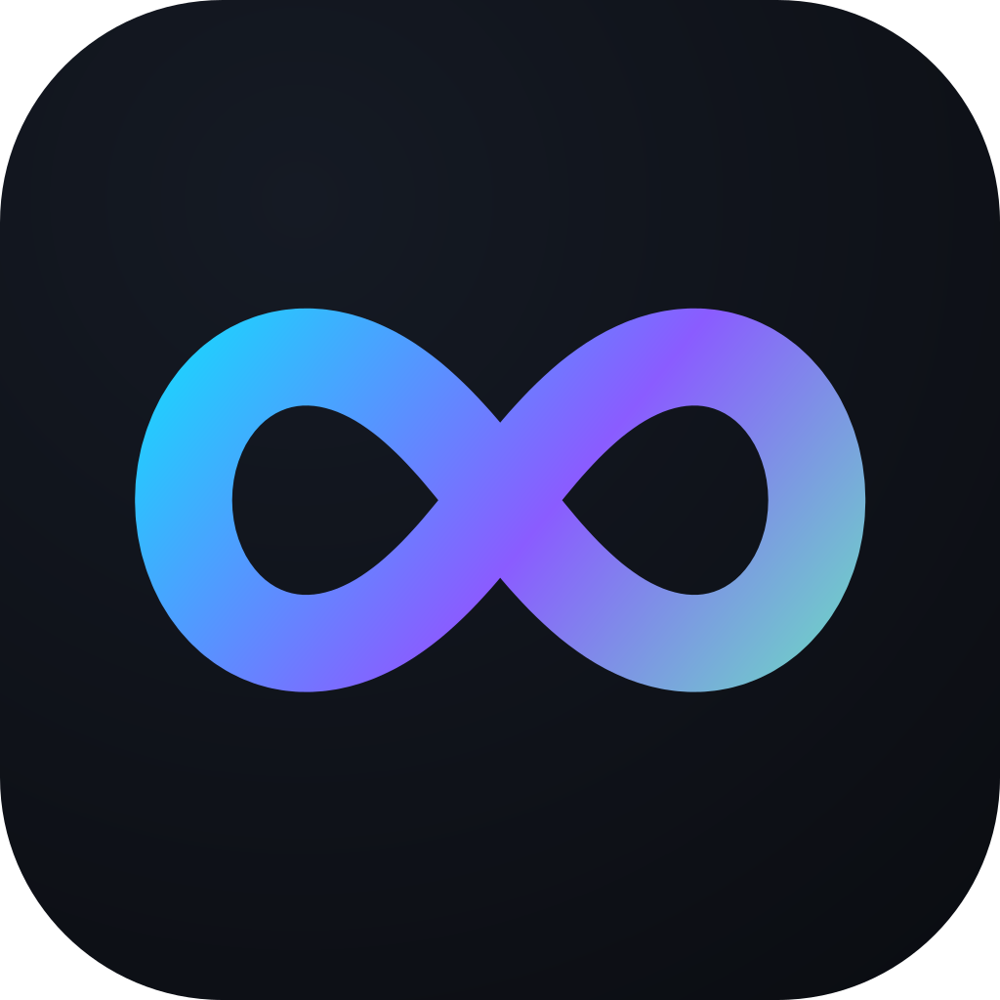

  

# Recall

**Find what's in your files by meaning. Entirely on your device, in Arabic and English.**

Recall is an on-device second brain. You pick the paths and the file types. It embeds what you allowed, and Find runs in that same process. No account. No cloud copy of your files. No hosted vector database.

## Why Recall

- **Arabic and English, end to end.** Right-to-left layout in both languages, an Arabic OCR reader beside the English one, and a text extractor that catches a broken Arabic PDF layer.
- **No helper process.** The embedder runs inside the app's process. No daemon, no sidecar, nothing to keep alive.
- **One network call, ever.** The model download. It carries no document name, no document text, no vector, and no device id. After it finishes, the app has no reason to touch the network.
- **A plan you can audit.** The roadmap below is a public per-task board, not a marketing page.
- **Built for phones first, not as an afterthought.** The same codebase ships to Android, iPhone, Windows, and Mac, and the stored vector widths exist to fit a phone's memory budget.

## What it can do

This is in the app today.

- Grant a folder and pick the file types. Code can be one of those types.
- Leave secrets, databases, lock files, and the built-in skip folders unread. You can add a skip. You cannot remove a built-in one.
- Download the text model, check SHA-256, and embed granted text.
- Find by meaning and by the words, then open the file.
- Switch the screens between Arabic and English.
- Name this device, and store an age cutoff of 2, 5, or 7 years. Sync stays off.
- On iOS, pick up new files when you open Recall. Other shells watch the granted folders.

Granted files may use other languages. A scored recall report is not in this tree yet.

## What v1 will do

This is the v1 product. Not all of this is in the tree yet.

- Search pictures, sampled video, and audio files when that type is on. There is no microphone.
- Read the words in a picture, and attach a transcript that already sits next to the media. There is no speech-to-text model.
- Pin an item so it stays easy to find.
- After 2, 5, or 7 years, let older pictures, video, and audio match on a shorter vector. Text does not age.
- Ship installers for Android, iPhone, Windows, and Mac. The weights are downloaded, not packed inside.

## Install and updates

No installer is published yet. The first artifact that will appear here is a Windows zip, tracked as task [P.2.1](docs/plan.md); the Android apk follows once the native library alignment task 7.2.4 passes; Mac and iOS artifacts are later decisions.

Updates are new downloads. Recall checks for nothing.

## Where it runs

v1 RIDs are `android-arm64`, `ios-arm64`, `win-x64`, `maccatalyst-arm64`, and `linux-x64`.

Builds today: `net10.0-android`, `net10.0-ios`, `net10.0-maccatalyst`, and `net10.0-windows10.0.19041.0`. .NET MAUI has no Linux target framework. The Linux shell is not in the tree. `linux-arm64` and `win-arm64` are not v1 RIDs.

## Roadmap

Recall's plan is public, per task, with honest statuses: [docs/plan.md](docs/plan.md) is the only progress table.

## Docs

Latest App Docs start at [docs/index.md](docs/index.md).

## Build

Build and release stay on the developer machine. This repository has no GitHub Actions workflow. [CONTRIBUTING.md](CONTRIBUTING.md) describes the flow.

The text class is LlamaTextEmbeddingEncoder, in-process llama.cpp. ZVec.NET 1.0.0-beta.6 stays in that same process. It is not on nuget.org. Restore uses the local feed in the user NuGet config. This repository does not publish that package.

## The future

v1 has no language model, no chat, and no generated summary. Later versions may add features that stay on the device and stay opt-in. This page will name them when they are decided.

## License

The license is [LICENSE](LICENSE). It is source-available. A commercial use is not granted.
