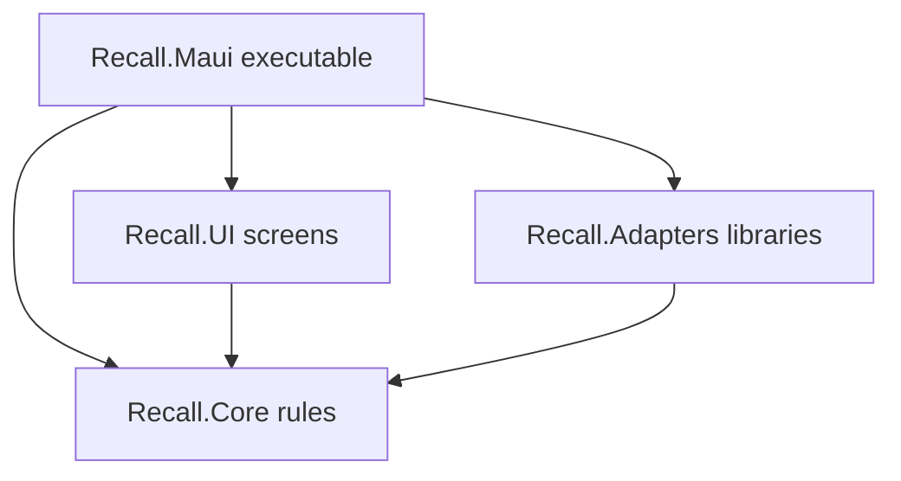
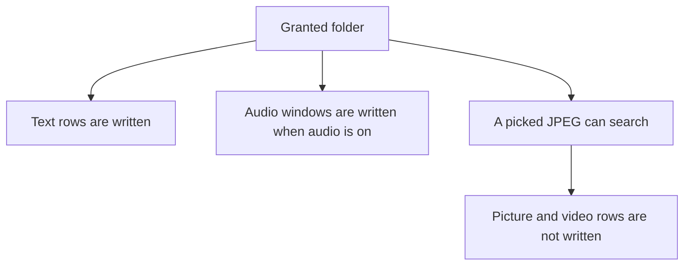

Status: in-code

## The four projects

Recall.Core owns a rule. Recall.UI starts a step and does not choose the rule. Recall.Adapters performs the library step, llama.cpp or ZVec. Recall.Maui performs the operating-system step and is the only executable. A screen cannot choose a stored width. A platform file cannot invent a content id.

## A folder becomes a grant

The person picks a folder. Core refuses a blank path, a duplicate, and a folder already inside a grant. A folder that contains smaller grants replaces those grants. Maui returns only the path the operating system allowed. The screen shows that result.

## A text file becomes a hit

Core chooses the prefix, the split, the content id, and the stored width of 512. Maui reads the granted file and records the hash in checkpoints.db so the same text is not embedded again. Adapters run the text model and write items_text. A new id is appended to the local op-log. The text and the vector stay on the device.

## Find and what else runs

Home asks Core to search. Core embeds the question once and cuts it to 512. Adapters fuse the vector list and the keyword list inside items_text and drop a path outside the grant. At most 20 files return. Opening a card asks Maui to open the local file. The result is opened, missing, or failed. Picture search runs when the person picks a JPEG and looks in items_image and items_video. Nothing writes those picture or video rows yet. Audio ingest runs on the MAUI host when the grant has audio on, and it writes windows into items_audio. The audio download follows the vision file and does not fetch a second weight. Speech-to-text is forbidden. An ONNX reader is not constructed.
