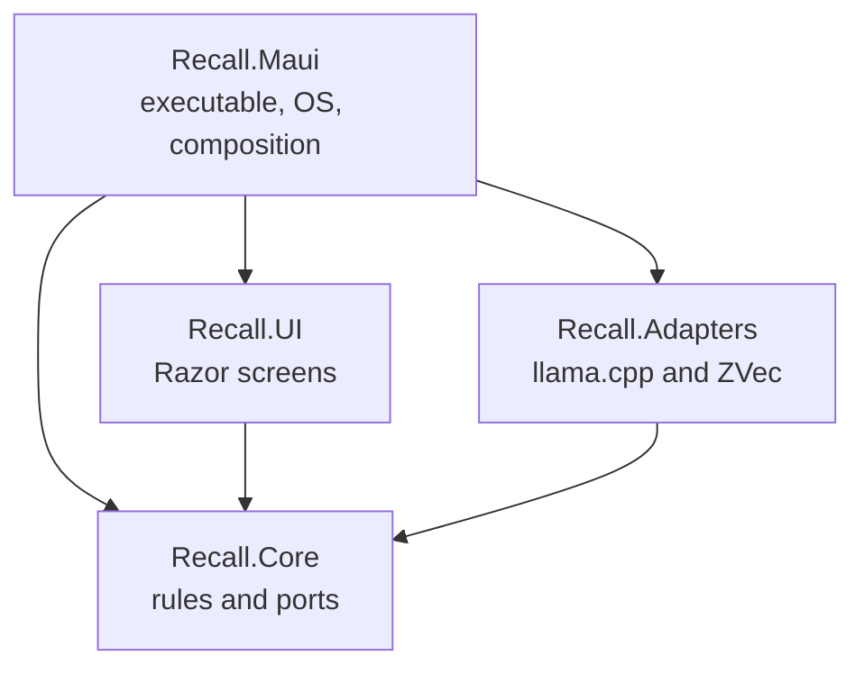

Status: in-code

# How Recall is put together

Recall keeps a private search index of folders the person allowed. The app runs on the device. The text of those files, and the vectors made from them, stay on the device. The network is used to download model weight files.

This page is the map of that design. The [file catalog](../code/map.md) still quotes source lines. [What each piece is for](pieces.md) says, in words, why each area of the tree exists.

## The four product projects

`Recall.slnx` builds one app from four product projects. Dependencies point inward. A screen cannot decide a stored width. A platform file cannot invent a second content id. The embedder cannot see a button.

`Recall.Core` is the rules. It has no MAUI, no Razor, and no HTTP client. It also has no reference to ZVec. Unit tests can run a grant rule, a chunk split, or a content id without a phone and without a model file. When Core needs the operating system, a vector database, or an encoder, it asks for a port. The port is an interface. The implementation lives outside Core.

`Recall.UI` is the Blazor screens. It references Core and talks to ports such as search, folder grants, and model download. It does not open llama.cpp and it does not open ZVec. One `ShellUiStore` holds the snapshot the screens share: theme, locale, route, and grants.

`Recall.Adapters` is the in-process machine-learning and index code. It references Core. It implements the text encoder, the vision encoder, the audio encoder, the text vector index, and the media vector index. Those libraries stay in the same process as the UI. There is no helper process and no listen port.

`Recall.Maui` is the only executable. It is a .NET 10 MAUI Blazor Hybrid app. It hosts the Razor UI, reads the embedded settings, and registers every service. It also implements the ports that touch the operating system: the folder picker, persisted grants, the device id, the HTTP download, the SQLite checkpoint file, the idle signal, and the video-frame sampler. Target frameworks are Android, iOS, Mac Catalyst, and Windows. `linux-x64` is a v1 runtime identifier. The Linux shell is open and is not in this project.

Three more kinds of project sit beside the app and are not shipped inside it.

`Recall.Benchmarks` measures the text index. `tests/Recall.UnitTests` checks rules with fakes. `tests/Recall.IntegrationTests` opens a real ZVec collection and the real llama.cpp embedder when the weight file is present. `tests/Recall.BenchTests` checks that a benchmark host is honest. `tests/Recall.CorpusTests` is the retrieval corpus project. `tools/corpus-builder` and `tools/mrl-eval` are offline command-line tools for the corpus and for Matryoshka width checks.

## Why the split exists

A stored width, a prefix string, a grant overlap, and a content id are product rules. They live once, in Core. The MAUI head supplies a path, a picker result, or a file stream. It does not choose the width.

The UI can be exercised against a fake search service. The index can be exercised without a screen. The encoder can be replaced behind `ITextEmbeddingEncoder` without rewriting Find.

Core registers headless defaults so a test host can call `AddRecallCore` alone. The MAUI registration runs afterward and replaces the defaults that must see the real device: the granted-file reader, the checkpoint database path, the op-log directory, the idle detector, and the local-content probe. The container resolves the later registration.

## What starts the process

`MauiProgram.CreateMauiApp` builds one process. That process contains the MAUI shell, the Razor UI, Core, in-process llama.cpp, and ZVec.

Startup reads the embedded `Recall.Maui.appsettings.json`. A missing stream throws `InvalidOperationException` with the message `Recall.Maui.appsettings.json is not embedded.` An optional `appsettings.secrets.json` under app data can overlay settings. It is not required.

From that configuration the host reads the text, vision, and audio download options, the model catalog, and the text-ingest extension list. It then calls `AddRecallCore`, `AddRecallUi`, and `AddRecallMauiPlatform`. The platform method registers the OS implementations and then calls `AddRecallAdapters` with the app-data model directory and the app-data vector directory.

`AddRecallCore` registers the rules: theme, locale, age cutoff, grants, index policy, device record, text search, text ingest, the watch coordinator, Index now, and the headless file reader. It does not open SQLite.

`AddRecallUi` registers `ShellUiStore`.

`AddRecallAdapters` registers the text model runtime, a lazy text encoder, a lazy token counter, `ZVecTextVectorIndex`, the vision runtime, the audio runtime, `ZVecMediaVectorIndex`, and picture search. A blank model directory or a blank vector directory is rejected.

MudBlazor is not registered.

## What is stored on the device

Preferences hold small settings: onboarding complete, folder grants, age cutoff, locale, theme, the device record, and the extra skip names the person added. The keys are listed on the [stores](../data/stores.md) page.

App data holds the downloaded weights under `models/text`, the ZVec databases under `zvec`, a daily op-log under `oplog`, and `checkpoints.db`.

`checkpoints.db` remembers which files were read, the content hash, the encoder-file hash, and whether a chunk is live, missing, or retired. It does not keep a copy of the source files.

The text collection is `items_text`. One row is one chunk of one file at stored width 512. The row keeps the vector, a folded keyword field, the raw note shown on the card, the path, the file name, the modified time, whether the path is still live, the encoder hash, the grant path, and the chunk ordinal.

Media collections are separate: `items_image`, `items_video`, and `items_audio`, each at width 768. A text vector is never written into those collections. A picture vector is never written into `items_text`.

The op-log appends a local insert or delete line for a content id. `SyncFeature.Enabled` is false. Nothing sends that log.

## How a granted text file becomes a hit

The person picks a folder. `ScopeGrantService` stores a `ScopeFolderGrant`: a path, a display name, the file kinds that are on, and an optional reopen token for platforms that need one. A blank path is refused. A path that is already granted is a duplicate. A folder inside an existing grant is refused. A folder that contains grants already stored replaces those children, so one tree has one grant. File kinds are text, image, video, audio, and code. Code is not a separate modality. A code file is ingested as text.

The models screen starts the text-weight download when that row has not started. `MauiModelDownloadService` is the only HTTP client. The request names the public weight file. It does not send a document name, document text, a vector, a device id, or a device name. The body is hash-checked before it is treated as ready. The accepted text file is `embeddinggemma-2-Q8_0.gguf`.

When the text model is ready, ingest walks each grant that has text or code turned on. A grant with both of those off is skipped. The platform reader yields documents from the folder. `TextIngestEngine` then does the work that must be identical on every device:

The file name becomes the title. The raw text is hashed. `TextChunkPlanner` keeps the whole note when it fits in the 8192-token budget, and otherwise splits it. `EmbeddingTaskPrefixes` wraps a document as `title: {title} | text: {content}` and wraps a query as `task: search result | query: {query}`. A prefix applied twice is a fault. The encoder returns the native 768-wide vector. `MatryoshkaVectorMath` cuts that vector to 512 and L2-normalizes the slice. Width 128 is rejected. A text width other than 512 is rejected.

`ContentIdBuilder` hashes `modality|source-hash|width|ordinal`. The same bytes at the same width and ordinal produce the same id, so a second path with the same content can share an id. `ZVecTextVectorIndex.TryInsert` writes the row into `items_text`. The op-log records an insert only when that write is new.

`checkpoints.db` records the file as finished with the hash and the encoder-file hash. A later pass with the same hash does not embed again. A different encoder hash marks the file for repair and re-embeds it under the same content id. A span that is almost all numbers is keyword-only: it is stored for BM25 and does not get a dense vector. `NumericSpanPolicy` makes that call.

`App` starts `ScopeWatchCoordinator` when the window is created and when it resumes, on Windows, Android, Mac Catalyst, and iOS. Each of those events asks for a rescan. `ForegroundScanService` diffs the grant against `checkpoints.db`. The filesystem watcher also starts on Windows, Android, and Mac Catalyst. The implementation selected for those three is `WindowsFileScopeWatcher`. iOS gets `DisabledScopeWatcher` and relies on the rescan. Creates, changes, renames, and deletes go through `ScopeChangeApplier`. A busy idle signal still allows the rescan, and it defers applying the buffered file events. The file is not dropped. Index now ingests a grant that has not finished.

Find on Home runs when the query has non-white-space text. The query is prefixed once, embedded once, and cut to 512 once. Search asks `items_text` for a dense HNSW list and a BM25 list, then fuses them inside ZVec with reciprocal rank fusion at rank constant 60. Any other constant is a fault. Each raw list is capped at 64. Hits outside the current grants are dropped. Hits whose checkpoint path was renamed are checked against the new path. One file keeps one card. At most 20 files return. The first five cards show immediately. Opening a card uses `ILocalFileOpener` and reports opened, missing, or failed.

## Pictures, video, and audio

Picture rows and video frames are separate from the text walk. Nothing in `src/` writes an `items_image` row or an `items_video` row. Audio is different. When a grant has audio or video turned on, `GrantedTextIngestService` also calls `IAudioFileIngest`. The headless registration is `DisabledAudioFileIngest`, which returns without reading. The MAUI host replaces that with `AudioFileIngest`.

Picture search on Home is wired. The person picks a JPEG. `PictureQueryGate` reads the vision download phase. If the vision weight is not ready, Home starts `DownloadVisionModelAsync` and waits. `PictureSearchService` embeds that JPEG once through `VisionModelRuntime` and searches `items_image` and `items_video`. It does not search `items_text`. Frames of one file collapse to the earliest start. The vision file is `mmproj-embeddinggemma-2-Q8_0.gguf`, loaded through llama.cpp after the text model is open, and unloaded when the job ends. `MediaContextPolicy` is the switch that keeps a single media context.

`IVideoFrameSamplerService` is registered per platform. Android uses `MediaMetadataRetriever` and emits one JPEG at each start from `FrameCadence` (every two seconds). Apple does the same with `AVAssetImageGenerator`. Windows uses `MediaComposition` thumbnails at 640 by 360 when the OS build is at least 22000. An older build throws `NotSupportedException` with `Windows frame thumbnails need Windows 11.` No screen calls the sampler yet. The audio ingest path does not use it.

`AudioFileIngest` skips a caption file. If the grant does not have the audio kind on, it records that through `AudioOffReport` and returns, including when the path is a video whose soundtrack would otherwise be read. When audio is on, `IAudioSource` reads the file. A WAV is decoded by `WavPcm`. Anything else goes through the platform decoder (`WindowsAudioSource`, `AndroidAudioSource`, or `AppleAudioSource`). `AudioWindows` plans overlapping windows of 11200 milliseconds with a hop of half that length. A short tail extends the last window. Each window is embedded to 768 numbers and inserted into `items_audio` with `MediaIndexInsert.AudioWindow`. `MauiSiblingFiles` reads a caption beside the media that shares its name (`.srt`, `.vtt`, `.sbv`, `.ass`, `.ssa`, `.ttml`), and those words are stored on the row. `SiblingTranscript` does not open a media container and it does not run speech-to-text. Speech-to-text is forbidden. After the windows of one file, `CloseAudio` runs.

The audio download phase still follows the vision file. `AudioModelDownloadOptions` defaults to `mmproj-embeddinggemma-2-Q8_0.gguf` in `models/vision`. `DownloadAudioModelAsync` marks audio ready when that file matches its hash, waits while vision is downloading, or starts the vision download, then copies the vision snapshot. It does not request a separate URL. The models screen does not auto-start the audio row. Home starts that method when the person picks an audio clip and the phase is still waiting. `AudioSearchService` embeds that clip once and searches `items_audio` inside grants that have audio turned on. Windows of one file collapse to the earliest start.

OCR is decided-absent as a reader. `OcrModelFiles` pins the detector and the English and Arabic reader hashes. `OcrReaderGate` refuses a hash that is not one of those. `OcrLineChoice` keeps the higher reader score. `BrokenArabic` detects a text layer whose Arabic letters were replaced by the replacement character. `OcrSessionSet` only flips three booleans. It does not construct an ONNX session.

## What the screens are

Routes are Home (`/`), landing, the four onboarding steps, lattice, folders, models, preferences, pin, and device. Phone tabs are Search, Lattice, Folders, and Preferences. The wide layout also shows Models.

Onboarding collects a grant and waits until the text model phase is Ready. Preferences stores theme, locale, and the age cutoff (2, 5, or 7 years, starting at 2) and lists the built-in skips. The age value is stored. A job that shortens old image, video, or audio vectors to 512 is not in the tree. Text stays at 512 and does not age.

Lattice is the page that shows sync is off. Pin is an empty state. A tray icon, a sign-in start item, and a global search shortcut are open and are not in the tree.

## What this design refuses

No web client. No clipboard, camera, screen, or microphone capture. No chat model and no generative summary. No speech-to-text. No sync transport. No second process for the embedder. No stored vector at 128 dimensions. No HNSW-RaBitQ. Weights are downloaded, not bundled in the installer.
