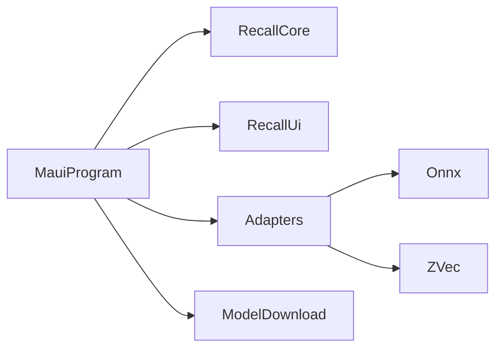

Status: in-code

## Process

One process hosts the MAUI shell, Razor UI, Core, ONNX Runtime, and ZVec. `MauiProgram` does not call `AddMudServices`. A tray or a hotkey does not add a process. None is in the tree.

## Network

`Recall.Core` has no `HttpClient`, `Socket`, `TcpListener`, or `UdpClient`. The only HTTP client is `MauiModelDownloadService` via `IHttpClientFactory`. The request names the public weight file. It does not send a document name, document text, vector, device id, or device name.

## Failure

Missing embedded `Recall.Maui.appsettings.json` throws `InvalidOperationException` with message `Recall.Maui.appsettings.json is not embedded.`

