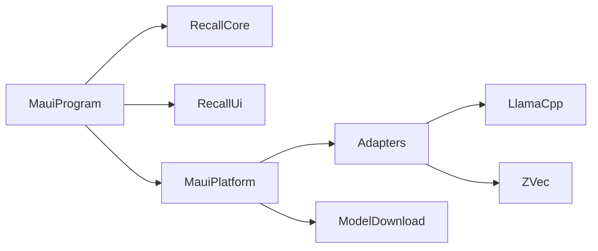

Status: in-code

## One process

One process hosts the MAUI shell, the Razor UI, Core, in-process llama.cpp, and ZVec. The vision embed loads the mmproj for one JPEG and closes it before returning. The audio embed can open a native audio context and leaves closing it to `CloseAudio`. A tray or a hotkey would not add a process. Neither is in the tree.

`MauiProgram` reads the embedded settings, registers Core, the UI store, and the platform services. The platform services register the adapters. `MauiProgram` does not call `AddMudServices`.

## Network

`Recall.Core` has no `HttpClient`, `Socket`, `TcpListener`, or `UdpClient`. The HTTP client is `MauiModelDownloadService`, created through `IHttpClientFactory`. The request names a public weight file. Text uses `embeddinggemma-2-Q8_0.gguf`. Vision uses `mmproj-embeddinggemma-2-Q8_0.gguf`. The audio download method does not name a third file. It follows the vision download, as [the design page](design.md) describes. The request does not send a document name, document text, a vector, a device id, or a device name.

## Failure at startup

A missing embedded `Recall.Maui.appsettings.json` throws `InvalidOperationException` with the message `Recall.Maui.appsettings.json is not embedded.`

