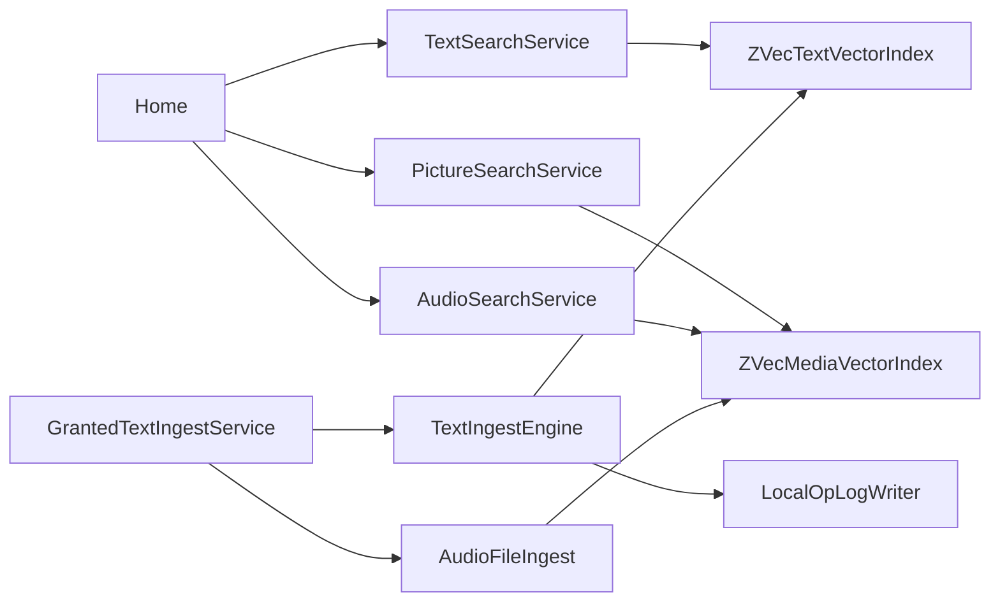

Status: in-code

## How a request moves

The full story is [How Recall is put together](design.md). This page is the short form of who calls whom.

Home calls `ITextSearchService.FindAsync` only when `TextFindSession` accepts the query. Find embeds the question once, cuts it to 512, and asks `ZVecTextVectorIndex`, which keeps the hit inside the grant.

A picture picked on Home calls `IPictureSearchService`. That embeds the JPEG once and searches `items_image` and `items_video`. It does not search `items_text`. An audio clip picked on Home calls `IAudioSearchService`, which embeds the PCM once and searches `items_audio`.

`GrantedTextIngestService` reads documents from `IGrantedTextReader` and calls `TextIngestEngine` when the grant has text or code. The grant pass then calls `IVisionFileIngest` for pictures and video frames and `IAudioFileIngest.IndexAsync` for audio paths (and video soundtracks when Audio is on). The MAUI host registers both ingest services. The engine embeds, cuts, and inserts text. `LocalOpLogWriter` records a text insert only when the text index accepts a new content id. The same ingest entry is reached from the watcher, from the foreground rescan, from window-open ingest, and from the header retry.

