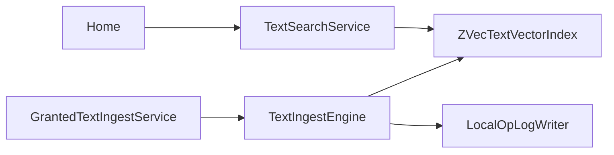

Status: in-code

## Who calls whom

`Home` calls `ITextSearchService.FindAsync` only when `TextFindSession.ShouldQuery` is true. `GrantedTextIngestService.IngestGrantedTextAsync` calls `IGrantedTextReader.ReadAsync` then `TextIngestEngine.IngestFileAsync`. `TextIngestEngine` calls `ITextEmbeddingEncoder.EmbedPrefixedTextAsync`, `MatryoshkaVectorMath.CutAndNormalize`, `ITextVectorIndex.TryInsert`, and `LocalOpLogWriter.AppendInsert` only when insert returns true. `TextSearchService.FindAsync` calls embed once, cut once, then `ITextVectorIndex.Search`. `ZVecTextVectorIndex.Search` calls `ScopeGrantPolicy.IsInsideGrant`.

