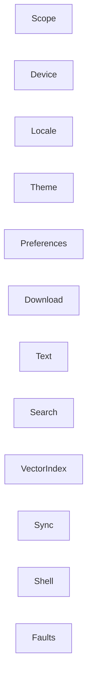

Status: in-code

## In words

A domain is one reason to change. Scope decides which folders may be read. Text turns a file into chunk ids. The vector index stores those ids. Search asks the index. Download fetches weights. The shell starts those jobs and does not invent their rules. The pages below say what each domain owns. The story of how they work together is [How Recall is put together](../architecture/design.md).

## Rule

A domain owns one reason to change.

## Map

A use case names the path and links here. It does not restate a branch.

- [Scope](scope.md)
- [Device](device.md)
- [Locale](locale.md)
- [Theme](theme.md)
- [Preferences](preferences.md)
- [Download](download.md)
- [Text](text.md)
- [Search](search.md)
- [Vector index](vector-index.md)
- [Sync](sync.md)
- [Shell](shell.md)
- [Faults](faults.md)

