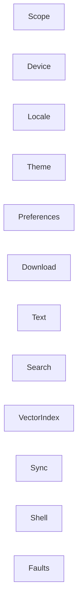

Status: in-code

## Rule

A domain owns one reason to change.

## Map

A use case names the path and links here. It does not restate a branch.

- [Scope](scope.md)
- [Device](device.md)
- [Locale](locale.md)
- [Theme](theme.md)
- [Preferences](preferences.md)
- [Download](download.md)
- [Text](text.md)
- [Search](search.md)
- [Vector index](vector-index.md)
- [Sync](sync.md)
- [Shell](shell.md)
- [Faults](faults.md)

