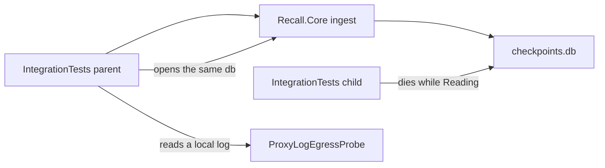

Status: in-code for the desktop benchmark row, Windows and Android publish scans, Linux unit tests, crash-restart, egress parser, crash-package lock, and local proof hosts. Open for the golden language list, a 60-minute egress capture, Mac compile restore on GitHub, and 16 KB `libzvec` alignment.

## Proof hosts

Windows, Linux in WSL or Docker, and Android on an emulator or a phone over adb are the local proof hosts. `ios-arm64` and `maccatalyst-arm64` stay in the solution and compile on a GitHub-hosted macOS runner through `apple-compile.yml`. A physical iPhone or Mac run is not a done-when. Platform code for those heads is still written.

## Measured

Task 2.2.5 is done. The desktop line is recorded in `docs/plan.md`: `Host: desktop`, `InsertOne` mean 30.66 us, `HybridTop20` mean 2,202.43 us, `LoadTextEncoder` mean 727.3 ms. The desktop encoder line is 800 ms. The mobile 60 ms and 600 ms cells were never measurable in Phase 2 and stay on task A.2.9. A connected phone cannot run this benchmark project, and an emulator label is not a phone number. The benchmark still exits without a number when `RECALL_TEXT_MODEL_DIR` is unset.

Task 7.2.1 is done on this machine: `WinX64Publish_ContainsNoWeight` and `AndroidApk_ContainsNoWeight` pass, `adb install -r` succeeded on a connected device, and `dotnet test tests/Recall.UnitTests/Recall.UnitTests.csproj -c Release` exited 0 in WSL. The publish trees contain no `.gguf` and no `.onnx`.

Task 7.2.2 is done: `CrashPackage_IsNotReferenced` passes. U3 stays open. No crash reporter package is referenced.

Task 7.1.2 is partial. `CrashRestart_ResumesFromCheckpoint` and the egress parser tests are in the tree. A log the test writes is not a 60-minute traffic record of the running app after model download.

Task 7.1.3 is not started. ADR 0008 names English, Arabic, Chinese, Hindi, and French for the retrieval golden set. Task 7.1.3 names English, Arabic, French, German, and Spanish. This page does not pick a list. OCR pages in that task wait on Epic 6.3. UI languages stay Arabic and English either way.

`ZVec.NET` 1.0.0-beta.6 is not on nuget.org. On this PC the package file is `C:\Users\DELL\.nuget\packages\zvec.net\1.0.0-beta.6\zvec.net.1.0.0-beta.6.nupkg` at 100650025 bytes. GitHub cannot store that file as a normal blob. `UglyToad.PdfPig` `1.7.0-custom-5` is in the same cache and is also absent from nuget.org. The macOS compile job cannot see this cache. A restore error that names `ZVec.NET` or `UglyToad.PdfPig` is recorded here with those paths and sizes. No package URL is added.

`libzvec_c_api.so` in that package measures four `PT_LOAD` segments with `p_align` 4096 on android-arm64. Task 7.2.4 stays open until a later package measures at least 16384. `Libzvec_LoadAlign_Is4096` locks the current measurement.

`apple-compile.yml` runs on `macos-27`, pins Xcode 27.1 through `setup-xcode`, and builds `net10.0-ios` / `ios-arm64` and `net10.0-maccatalyst` / `maccatalyst-arm64` without signing or uploading weights. Run `40077057050` on 24 Oct 2026 reached restore and build but failed because the default `Xcode.app` on `macos-26` was 26.6 while .NET for iOS 27.1.10018 requires Xcode 27.1. A restore failure that names `ZVec.NET` or `UglyToad.PdfPig` is recorded here with the cache path and byte count above.

