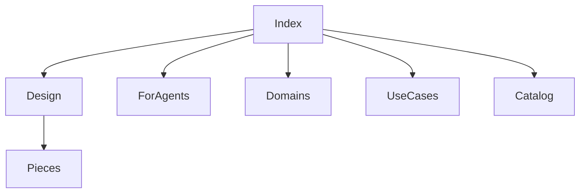

## What this repo is

Recall is one .NET 10 MAUI Blazor Hybrid process. The accepted text runtime is in-process llama.cpp, and ZVec.NET stays in that same process. The class in the tree is LlamaTextEmbeddingEncoder. v1 does not send user content or vectors off the device.

The license file is a source-available grant, copyright 2026 Adam Systems EG. A commercial use is not granted. An organization whose counted gross revenue is 100,000 USD or more is not granted use of the software or a version made from it. Those requests go to ahmed.samir.abdelaal@gmail.com. It is not an OSI-approved open source license. The app does not ask for revenue.

## How to read

Start with [How Recall is put together](architecture/design.md). That page explains the projects, why they are split, and how a granted file becomes a search hit. [What each piece is for](architecture/pieces.md) names each area in words. Then use a domain page or a use-case page for one question. [for-agents.md](for-agents.md) is the index of those questions.

A page marked `in-code` names behavior the tree actually runs. A page marked `decided-absent` is an accepted rule with no implementing class. A page marked `open` must not be implemented by guessing. A page marked `forbidden` must not be built. The [file catalog](code/map.md) quotes source lines. It is a checklist, not the explanation.

## What exists now

In the tree now: shell, Arabic and English chrome, device record, folder grants, text model download, text embed at stored width 512, one `items_text` collection, hybrid Find with media-word append, Find ingest counts per enabled kind from `checkpoints.db`, a header RAM and CPU and GPU strip on the MAUI shell, picture and audio Find across long and `_old` collections, picture search against `items_image` and `items_video`, vision-weight download when that search is waiting, local file open, age cutoff stored as 2, 5, or 7 with move and pin services (production shrink fail-closed until a recall corpus exists), sync flag off, local op-log insert, delete, pin, and unpin lines, scope watchers, `checkpoints.db`, Code grant flag, skip-folder and secret filters with filterable built-in chips on Preferences. When a grant has audio turned on, the MAUI host indexes that audio, and a video soundtrack on the same grant, as windows in `items_audio`. Home can search that collection with a picked clip. The audio download phase follows the vision file. It does not fetch a separate weight. The MAUI host runs ONNX OCR when the detector and reader files are present.

Progress numbers live only in [plan.md](plan.md). The design is [architecture/design.md](architecture/design.md). Domains start at [domains/index.md](domains/index.md). Use cases start at [use-cases/index.md](use-cases/index.md). The file catalog is [code/map.md](code/map.md).

## What is not in the tree

Not in the tree: a Find pin control, a shipped age recall corpus, the OCR golden set of 30 Arabic, 30 English, and 20 French, German, and Spanish pages, the five-language retrieval report, a four-shell release. linux-x64 is a v1 RID. The Linux shell is open and is not in the tree. Windows tray, Mac menu bar, sign-in start, and search shortcut. A Linux tray, sign-in start, and search shortcut are open and are not in the tree. The public remote is https://github.com/ahmedSamir50/Recall. Branch main is the pushed branch. apple-compile.yml compiles ios-arm64 and maccatalyst-arm64. A physical Apple run is not a done-when. The Apple platform files stay in the tree. Speech-to-text is forbidden.

