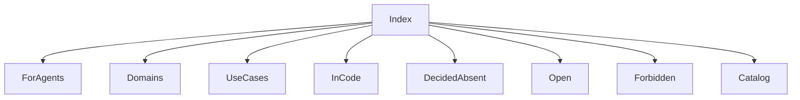

## What this repo is

Recall is one .NET 10 MAUI Blazor Hybrid process. The accepted text runtime is in-process llama.cpp, and ZVec.NET stays in that same process. The class in the tree is still the ONNX text encoder. v1 does not send user content or vectors off the device.

The license file is a source-available grant, copyright 2026 Adam Systems EG. A commercial use is not granted. An organization whose counted gross revenue is 100,000 USD or more is not granted use of the software or a version made from it. Those requests go to ahmed.samir.abdelaal@gmail.com. It is not an OSI-approved open source license. The app does not ask for revenue.

## How to read

Read this page, then [for-agents.md](for-agents.md), then the domain page or the use-case page for the question. A page marked `in-code` names types that exist. A page marked `decided-absent` is an accepted rule with no implementing class. A page marked `open` must not be implemented by guessing. A page marked `forbidden` must not be built.

## What exists now

In the tree now: shell, Arabic and English chrome, device record, folder grants, text model download, text embed at stored width 512, one `items_text` collection, hybrid Find, local file open, age cutoff stored as 2, 5, or 7, sync flag off, local op-log insert and delete lines, scope watchers, `checkpoints.db`, Code grant flag, skip-folder and secret filters.

Progress numbers live only in [plan.md](plan.md). Domains start at [domains/index.md](domains/index.md). Use cases start at [use-cases/index.md](use-cases/index.md). The file catalog is [code/map.md](code/map.md).

## What is not in the tree

Not in the tree: vision, video sampling, OCR, audio encoder, sibling transcripts, pin storage, vector aging, golden recall report, four-shell release. Windows tray, Mac menu bar, sign-in start, and search shortcut. A Linux tray, sign-in start, and search shortcut are open and are not in the tree. The public remote is https://github.com/ahmedSamir50/Recall. Branch main is the pushed branch. A GitHub Actions workflow is open and is not in the tree.

