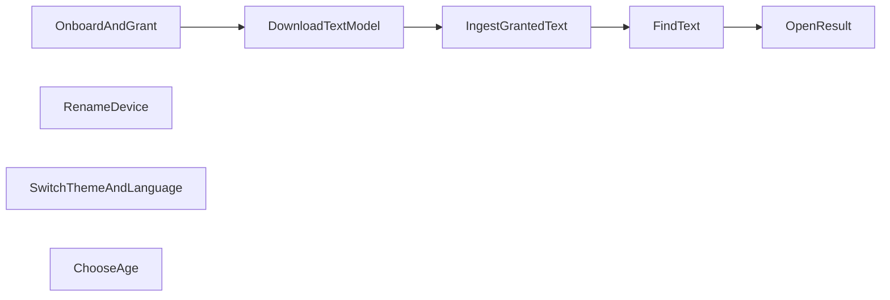

Status: in-code

## In code

- [onboard-and-grant.md](onboard-and-grant.md)
- [download-text-model.md](download-text-model.md)
- [ingest-granted-text.md](ingest-granted-text.md)
- [find-text.md](find-text.md)
- [open-result.md](open-result.md)
- [rename-device.md](rename-device.md)
- [switch-theme-and-language.md](switch-theme-and-language.md)
- [choose-age.md](choose-age.md)
- [reset-local-data.md](reset-local-data.md)

## Not in the tree

- [absent.md](absent.md)

